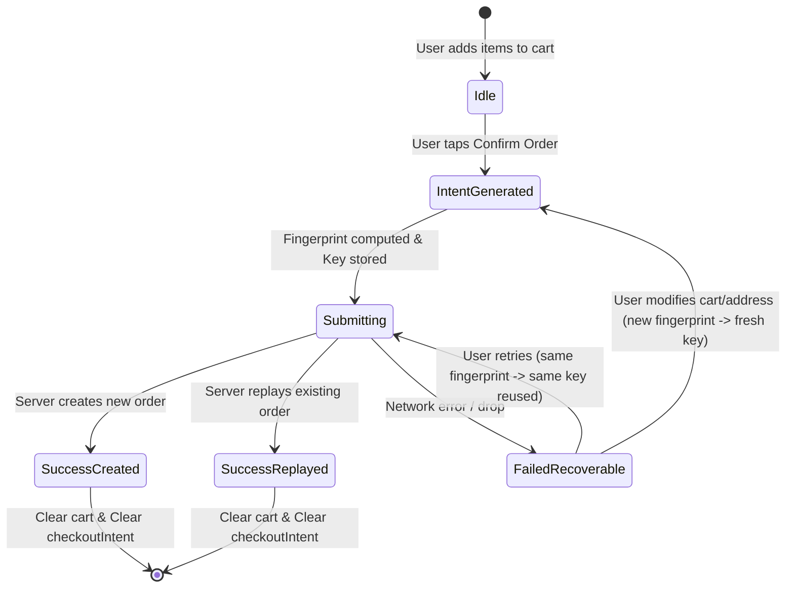

# Data Model: Order Placement Idempotency

**Feature**: `011-order-placement-idempotency`
**Date**: 2026-10-19

## 1. Database Schema Changes (PostgreSQL)

### `public.orders` Table Extension

```sql
-- Add nullable idempotency_key column
ALTER TABLE public.orders 
ADD COLUMN idempotency_key uuid;

-- Unique constraint ensuring single order per customer + key combination
CREATE UNIQUE INDEX orders_customer_idempotency_idx 
ON public.orders (customer_id, idempotency_key);

-- Column guard immutability rule
-- Added into public.orders_column_guard() before update trigger
if new.idempotency_key is distinct from old.idempotency_key then
  raise exception 'orders_column_guard: idempotency_key is immutable' using errcode = '23514';
end if;
```

#### Field Attributes
- **Column**: `idempotency_key`
- **Data Type**: `uuid`
- **Nullability**: `NULL` (Required for new orders via `place_order` RPC; nullable for legacy historical orders).
- **Index**: Unique B-tree index on `(customer_id, idempotency_key)`.
- **Immutability**: Enforced by `orders_column_guard()` trigger.

---

## 2. Domain Entities & Interfaces (TypeScript)

### `src/features/orders/domain/entities/Order.ts`
```typescript
export interface Order {
  id: string;
  customerId: string;
  driverId: string | null;
  storeId: string;
  storeName: string;
  status: OrderStatus;
  deliveryAddressSnapshot: string;
  deliveryAddressLabel: string | null;
  paymentMethod: PaymentMethod;
  couponCode: string | null;
  discountAmount: MoneyAmount;
  subtotalAmount: MoneyAmount;
  deliveryFee: MoneyAmount;
  totalAmount: MoneyAmount;
  idempotencyKey?: string | null; // Added
  createdAt: string;
  acceptedAt: string | null;
  deliveredAt: string | null;
  updatedAt: string;
  items: OrderItem[];
}
```

### `src/features/orders/domain/repositories/OrderRepository.ts`
```typescript
export interface PlaceOrderInput {
  storeId: string;
  deliveryAddressId: string;
  paymentMethod: 'cash_on_delivery';
  couponCode?: string | null;
  idempotencyKey: string; // Mandatory for all placement calls
  items: {
    productId: string;
    variantId?: string | null;
    quantity: number;
    addonIds: string[];
  }[];
}
```

---

## 3. Client State & Persistence Entities

### `src/features/cart/domain/entities/CheckoutIntent.ts` (Pure Domain)
```typescript
export interface CheckoutIntent {
  idempotencyKey: string;
  intentFingerprint: string;
}
```

### `src/features/cart/application/cartSlice.ts` (Redux Cart State)
```typescript
interface CartState {
  storeId: string | null;
  storeName: string | null;
  items: CartItem[];
  conflictState: {
    isOpen: boolean;
    pendingItem: AddItemPayload | null;
    pendingBatch: BatchPayload | null;
  };
  checkoutIntent: CheckoutIntent | null; // Added
}
```

### AsyncStorage Serialization Format (`@sari3_cart_storage_v1`)
```json
{
  "storeId": "uuid | null",
  "storeName": "string | null",
  "items": [],
  "checkoutIntent": {
    "idempotencyKey": "uuid",
    "intentFingerprint": "string"
  }
}
```
*Note: Backwards compatible with legacy storage blobs where `checkoutIntent` is undefined.*

---

## 4. State Lifecycle & Transitions


