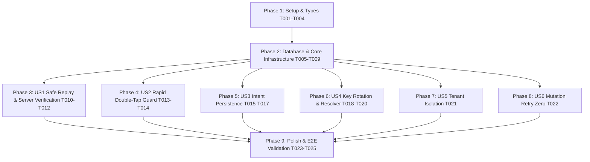

# Implementation Tasks: Order Placement Idempotency

**Feature**: `011-order-placement-idempotency`
**Date**: 2026-10-19
**Spec**: [spec.md](spec.md) | **Plan**: [plan.md](plan.md)

---

## Phase 1: Setup (Shared Infrastructure & Types)

**Purpose**: Define TypeScript types, domain models, and migration scripts required for idempotency.

- [x] T001 [P] Create checkout intent entity definition in `src/features/cart/domain/entities/CheckoutIntent.ts` with `{ idempotencyKey: string; intentFingerprint: string }`
- [x] T002 [P] Extend `Order` domain entity with `idempotencyKey?: string | null` in `src/features/orders/domain/entities/Order.ts`
- [x] T003 [P] Update `PlaceOrderInput` interface in `src/features/orders/domain/repositories/OrderRepository.ts` to require `idempotencyKey: string`
- [x] T004 [P] Create migration file `supabase/migrations/20261019180000_order_placement_idempotency.sql` containing schema alterations, index, trigger, and updated `place_order` RPC

---

## Phase 2: Foundational (Database & Core Infrastructure)

**Purpose**: Database schema migration, immutability guard trigger, concurrency lock, and RPC replay logic.

**⚠️ CRITICAL**: Must complete before user story verification can begin.

- [x] T005 Add `idempotency_key uuid` column and unique index `orders_customer_idempotency_idx` on `public.orders (customer_id, idempotency_key)` in `supabase/migrations/20261019180000_order_placement_idempotency.sql`
- [x] T006 Update `public.orders_column_guard()` trigger function in `supabase/migrations/20261019180000_order_placement_idempotency.sql` to enforce immutability: `if new.idempotency_key is distinct from old.idempotency_key then raise exception 'orders_column_guard: idempotency_key is immutable' using errcode = '23514'; end if;`
- [x] T007 Implement updated `public.place_order(p_payload jsonb)` RPC in `supabase/migrations/20261019180000_order_placement_idempotency.sql` with `v_idempotency_key` extraction, `MISSING_IDEMPOTENCY_KEY` validation, `pg_advisory_xact_lock(hashtext(v_customer_id::text), hashtext(v_idempotency_key::text))` concurrency serialization, and pure replay return for existing `(customer_id, idempotency_key)`
- [x] T008 Apply migration `supabase/migrations/20261019180000_order_placement_idempotency.sql` to live Supabase database and verify with `pg_get_functiondef`
- [x] T009 Update `SupabaseOrderRepository.placeOrder` in `src/features/orders/infrastructure/SupabaseOrderRepository.ts` to pass `idempotency_key: input.idempotencyKey` inside `p_payload` to the RPC

**Checkpoint**: Database supports atomic concurrency serialization, pure replay, and rejects missing keys; repository passes the key.

---

## Phase 3: User Story 1 - Safe Checkout Retry & Server Replay (Priority: P1) 🎯 MVP

**Goal**: Guarantee that retried or repeated `place_order` calls with the same idempotency key return the original order without creating a duplicate order row or consuming a second coupon redemption.

**Independent Test**: Execute Scenario 1 and Scenario 2 from `quickstart.md` on the live database inside a rolled-back transaction. Sequential calls with the same key must return matching order IDs, record exactly 1 order row, count 1 coupon redemption, and calls without an idempotency key must reject with `MISSING_IDEMPOTENCY_KEY`.

- [x] T010 [US1] Verify missing and malformed idempotency key rejection via live database script per `quickstart.md#scenario-2`
- [x] T011 [US1] Verify sequential replay idempotency and coupon redemption preservation via live database script per `quickstart.md#scenario-1`
- [x] T012 [US1] Verify column guard immutability enforcement on `idempotency_key` via live database script per `quickstart.md#scenario-3`

**Checkpoint**: At this point, the backend is strictly idempotent; sequential retries with the same key never duplicate orders or coupon deductions.

---

## Phase 4: User Story 2 - Rapid Double-Tap Protection (Priority: P1)

**Goal**: Block rapid physical multi-taps synchronously on the mobile client and serialize any racing backend calls via transaction advisory locks.

**Independent Test**: Rapidly double-tap the checkout confirmation button in the UI: only one network mutation fires. Simultaneously, simulated concurrent database calls with the same key serialize and produce exactly one order.

- [x] T013 [US2] Add synchronous `isSubmittingRef` guard in `src/app/checkout.tsx` to immediately drop secondary taps prior to React render state updates
- [x] T014 [US2] Verify concurrent request serialization with `pg_advisory_xact_lock` ensuring zero duplicate rows under simultaneous execution

**Checkpoint**: Client drops rapid repeated taps synchronously; server transaction lock prevents race conditions.

---

## Phase 5: User Story 3 - Persistence of Checkout Intent Across App Kill & Restart (Priority: P1)

**Goal**: Preserve active checkout key and purchase intent fingerprint in AsyncStorage so app restarts during checkout safely reuse the key and recover existing orders.

**Independent Test**: Stage an order in checkout, initiate checkout, terminate the app process, restart the app, and confirm again. The app reuses the persisted intent key, detects the previously placed order, and routes to order details without duplicating the order.

- [x] T015 [P] [US3] Add `checkoutIntent` state, `setCheckoutIntent`, and `clearCheckoutIntent` actions, and update `hydrateCart` in `src/features/cart/application/cartSlice.ts`
- [x] T016 [US3] Update `initializeCartPersistence()` and store subscription in `src/shared/lib/store.ts` to serialize, persist, and hydrate `checkoutIntent` under `@sari3_cart_storage_v1`
- [x] T017 [US3] Update `checkout.tsx` to clear `checkoutIntent` upon confirmed order success (`placeOrderMutation.onSuccess`) alongside `clearCart()`

**Checkpoint**: Checkout key and purchase fingerprint survive app termination and restart cleanly.

---

## Phase 6: User Story 4 - Automatic Key Rotation on Cart or Checkout Modifications (Priority: P2)

**Goal**: Ensure that whenever cart items, quantities, delivery address, or coupon code change, the system generates a fresh idempotency key rather than reusing a stale key.

**Independent Test**: Run unit tests in `src/features/cart/application/__tests__/checkoutIntentResolver.test.ts`. Modified cart details rotate to a new UUID; unchanged cart details reuse the stored key.

- [x] T018 [P] [US4] Write unit tests in `src/features/cart/application/__tests__/checkoutIntentResolver.test.ts` validating fingerprint generation, key reuse on match, key rotation on cart/address/coupon mismatch, and deterministic item sorting
- [x] T019 [US4] Implement `computeIntentFingerprint` and `resolveCheckoutIntent` in `src/features/cart/application/checkoutIntentResolver.ts` (pure TypeScript, zero React/Expo imports)
- [x] T020 [US4] Wire `resolveCheckoutIntent` into `src/app/checkout.tsx`, injecting `* as Crypto from 'expo-crypto'`'s `randomUUID()` at the presentation boundary and dispatching `setCheckoutIntent` to Redux

**Checkpoint**: Cart or checkout changes generate fresh keys; retries of identical purchases reuse the active key.

---

## Phase 7: User Story 5 - Multi-Customer & Tenant Scoping Isolation (Priority: P2)

**Goal**: Guarantee that idempotency keys are strictly scoped to the authenticated caller's account, preventing cross-customer collisions or data leaks.

**Independent Test**: Submit an order for Customer A with a specific key. Then, authenticate as Customer B and submit an order with the identical key. Both orders are created independently for their respective owners.

- [x] T021 [US5] Verify cross-customer idempotency key isolation on the live database by executing `place_order` with the same key under two different customer JWT contexts in a rolled-back transaction

**Checkpoint**: Multi-tenant isolation verified; keys are strictly customer-scoped.

---

## Phase 8: User Story 6 - Elimination of Blind Mutation Retries (Priority: P3)

**Goal**: Configure TanStack Query to never automatically retry mutating requests when transient network disconnects occur.

**Independent Test**: Verify that `queryClient.defaultOptions.mutations.retry === 0` and that a simulated network disconnect on mutation does not trigger automatic background resends.

- [x] T022 [US6] Set `mutations: { retry: 0 }` in `src/shared/lib/queryClient.ts` to prevent automatic re-dispatch of mutations with unknown outcomes

**Checkpoint**: Blind automatic network retries for write operations eliminated.

---

## Phase 9: Polish & Cross-Cutting Verification

**Purpose**: End-to-end validation, test execution, privilege verification, and code cleanup.

- [x] T023 Run Jest unit test suite (`npm test`) across all affected modules (`checkoutIntentResolver.test.ts`, `cartSlice.ts`) and ensure clean passage
- [x] T024 Verify live database function privileges on `place_order` with `has_function_privilege` ensuring `REVOKE FROM PUBLIC, anon; GRANT TO authenticated;` remain intact
- [x] T025 Run full end-to-end checkout flow validation on simulator/device per `specs/011-order-placement-idempotency/quickstart.md`

---

## Dependencies & Execution Order

### Parallel Opportunities

- **Phase 1**: T001, T002, T003, T004 can all be created in parallel (different files).
- **Phase 5 & Phase 6**: T015 (cartSlice) and T018 (resolver tests) can be worked on in parallel.
- **Phase 8**: T022 (`queryClient.ts`) is independent and can be completed in parallel with client UI tasks.

---

## Implementation Strategy: MVP First

1. **Foundational & Backend MVP (Phase 1, 2, 3)**:
   - Apply migration to add `idempotency_key` column, unique index, `orders_column_guard`, and updated `place_order` RPC.
   - Run live database rollback tests to verify pure replay and coupon preservation.
2. **Client Intent Persistence & In-Flight Guard (Phase 4, 5, 6, 8)**:
   - Implement `checkoutIntentResolver.ts` and unit tests.
   - Wire intent persistence to Redux and AsyncStorage in `cartSlice.ts` and `store.ts`.
   - Update `checkout.tsx` with ref guard and intent resolution.
   - Set `mutations.retry = 0` in `queryClient.ts`.
3. **Validation & Polish (Phase 7, 9)**:
   - Verify tenant isolation and run full end-to-end checkout test.
