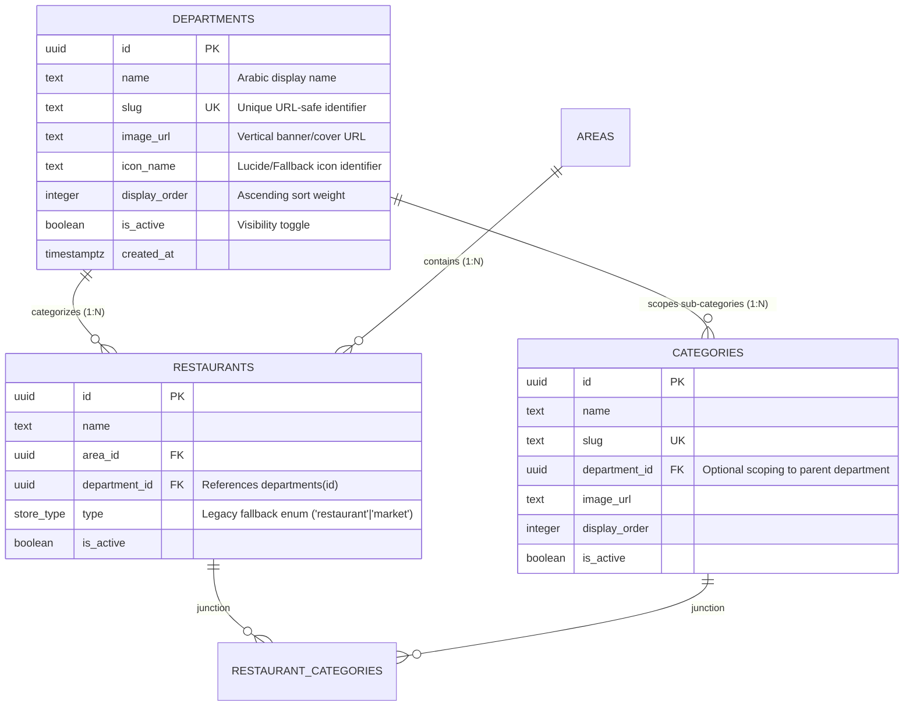

# Data Model: Dynamic Customizable Home Categories Grid

**Feature Branch**: `014-dynamic-home-categories`
**Date**: 2026-10-23
**Status**: Complete

## 1. Relational Entities & Schema



---

### Entity: `Department` (Top-Level Vertical)
Represents a top-level business department displayed on the customer home screen grid (e.g., Supermarket, Restaurants, Pharmacies).

- **Table**: `public.departments`
- **Fields**:
  - `id`: `UUID` (Primary Key, Default `gen_random_uuid()`)
  - `name`: `TEXT NOT NULL` (e.g., "سوبرماركت", "مطاعم", "صيدليات")
  - `slug`: `TEXT NOT NULL UNIQUE` (e.g., "supermarket", "restaurants", "pharmacies")
  - `image_url`: `TEXT NULL` (High-quality asset URL)
  - `icon_name`: `TEXT NULL` (Fallback icon identifier, e.g. "ShoppingBasket", "Utensils", "Pill")
  - `display_order`: `INTEGER NOT NULL DEFAULT 0` (Used for ordering: `ORDER BY display_order ASC`)
  - `is_active`: `BOOLEAN NOT NULL DEFAULT true` (Visibility filter: `WHERE is_active = true`)
  - `created_at`: `TIMESTAMPTZ NOT NULL DEFAULT now()`

- **Validation Rules**:
  - `name` cannot be empty.
  - `slug` must be lowercase alphanumeric with hyphens, unique across all departments.
  - `display_order` must be non-negative integer.

- **Indexes**:
  - `departments_display_order_idx`: `CREATE INDEX departments_display_order_idx ON public.departments (display_order) WHERE is_active = true;`

---

### Entity Extension: `Store` (`public.restaurants`)
Represents an individual merchant.

- **New Field**:
  - `department_id`: `UUID NULL REFERENCES public.departments(id) ON DELETE SET NULL`
- **Existing Fields Retained**:
  - `id`: `UUID PK`
  - `name`: `TEXT`
  - `area_id`: `UUID FK`
  - `type`: `public.store_type` (`'restaurant' | 'market'` — retained for internal store view labels `store/[id].tsx`)
  - `address`, `rating`, `is_active`, `image_url`, etc.

- **Indexes**:
  - `restaurants_area_department_idx`: `CREATE INDEX restaurants_area_department_idx ON public.restaurants (area_id, department_id) WHERE is_active = true;`

---

### Entity Extension: `Category` (`public.categories`)
Represents a cuisine or store-level sub-category (e.g., Grills, Pizza, Dairy, Beverages).

- **New Field**:
  - `department_id`: `UUID NULL REFERENCES public.departments(id) ON DELETE SET NULL`
- **Behavior**:
  - If `department_id` is set, the category belongs exclusively to that department.
  - If `department_id` is null, the category is considered a general/shared cuisine tag.

---

## 2. Seed Data (6 Core Verticals)

| Slug | Name (Arabic) | Default Order | Suggested Icon |
|------|---------------|---------------|----------------|
| `restaurants` | مطاعم | 1 | `Utensils` |
| `supermarket` | سوبرماركت | 2 | `ShoppingBasket` |
| `pharmacies` | صيدليات | 3 | `Pill` |
| `meat-poultry` | لحوم ودواجن | 4 | `Beef` |
| `bakeries-sweets` | مخبوزات وحلويات | 5 | `Cake` |
| `pet-shops` | مستلزمات حيوانات | 6 | `Cat` |

---

## 3. TypeScript Domain Models

### `Department` (`src/features/departments/domain/entities/Department.ts`)
```typescript
export interface Department {
  id: string;
  name: string;
  slug: string;
  imageUrl: string | null;
  iconName: string | null;
  displayOrder: number;
  isActive: boolean;
  createdAt: string;
}
```

### Updated `Store` (`src/features/restaurants/domain/entities/Store.ts`)
```typescript
export interface Store {
  id: string;
  name: string;
  type: StoreType; // Legacy 'restaurant' | 'market'
  departmentId?: string | null;
  departmentName?: string | null;
  description: string | null;
  imageUrl: string | null;
  address: string;
  rating: number | null;
  isOpen: boolean;
  category: string | null;
  categories?: readonly CuisineCategory[];
  areaId: string;
  createdAt: string;
}
```
