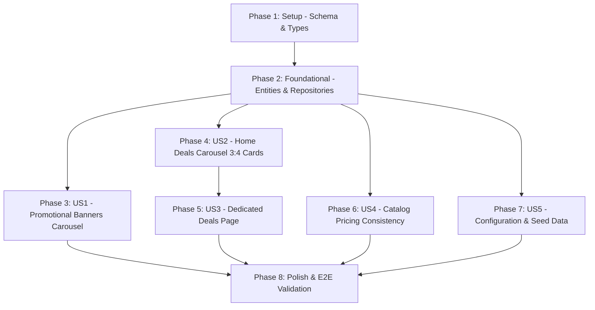

# Tasks: Dynamic Promotional Banners & Product Exclusive Deals

**Feature**: `015-promotions-and-deals`  
**Date**: 2026-10-24  
**Status**: Ready for Implementation  
**Spec**: [spec.md](file:///home/youssef/Documents/sari3_improve_ui/sari3-app3/specs/015-promotions-and-deals/spec.md) | **Plan**: [plan.md](file:///home/youssef/Documents/sari3_improve_ui/sari3-app3/specs/015-promotions-and-deals/plan.md)  

---

## Phase 1: Setup (Shared Infrastructure)

**Purpose**: Database schema migration and type generation for promotional banners and product deals

- [ ] T001 Create database migration in `supabase/migrations/20261024000002_promotions_and_deals.sql` adding `store_id UUID REFERENCES public.restaurants(id) ON DELETE SET NULL` to `public.promotions`, adding `original_price INTEGER CHECK (original_price IS NULL OR original_price > 0)` and stored generated column `is_deal BOOLEAN GENERATED ALWAYS AS (original_price IS NOT NULL AND original_price > price) STORED` to `public.products`, and creating partial index `idx_products_active_deals ON public.products (restaurant_id, is_available) WHERE is_deal = true AND is_available = true`
- [ ] T002 Apply migration `supabase/migrations/20261024000002_promotions_and_deals.sql` to Supabase via MCP and update TypeScript types in `src/shared/types/supabase.ts`

---

## Phase 2: Foundational (Blocking Prerequisites)

**Purpose**: Core domain entities, repository contracts, and application hooks required by all user stories

**⚠️ CRITICAL**: No user story work can begin until this phase is complete

- [ ] T003 [P] Update Promotion entity in `src/features/promotions/domain/entities/Promotion.ts` adding `storeId?: string | null` and updating `PromotionTargetType = 'store' | 'product' | 'announcement'`
- [ ] T004 [P] Update Product entity in `src/features/products/domain/entities/Product.ts` adding optional field `originalPrice?: MoneyAmount | null`
- [ ] T005 [P] Create DealProduct entity in `src/features/products/domain/entities/DealProduct.ts` extending `Product` with `originalPrice: number`, `discountPercentage: number`, `storeName: string`, `storeRating: number | null`, `storeIsOpen: boolean`, and `departmentId: string | null`
- [ ] T006 Update `SupabasePromotionRepository.ts` in `src/features/promotions/infrastructure/SupabasePromotionRepository.ts` to map `store_id` to `storeId` and query active promotions ordered by `display_order`
- [ ] T007 Extend `ProductRepository.ts` in `src/features/products/domain/repositories/ProductRepository.ts` and `SupabaseProductRepository.ts` in `src/features/products/infrastructure/SupabaseProductRepository.ts` with `getExclusiveDeals({ areaId, departmentId, limit })` querying `products` joined with `restaurants` where `is_deal = true`, `is_available = true`, and `restaurants.area_id = areaId`
- [ ] T008 [P] Create `usePromotions.ts` hook in `src/features/promotions/application/hooks/usePromotions.ts` using TanStack Query key `['promotions', 'active']` with 5-minute `staleTime`
- [ ] T009 [P] Create `useExclusiveDeals.ts` hook in `src/features/products/application/hooks/useExclusiveDeals.ts` using TanStack Query key `['products', 'deals', areaId, departmentId]` with 2-minute `staleTime`

**Checkpoint**: Foundation ready - user story implementation can now begin

---

## Phase 3: User Story 1 - Auto-Sliding Promotional Banners on Home Screen (Priority: P1) 🎯 MVP Part 1

**Goal**: Display an auto-sliding promotional banner carousel below the static yellow greeting banner and above the categories grid, supporting 3.5s auto-slide, touch pause, real-time pagination dots, and dual store/announcement tap targeting.

**Independent Test**: Launch the home screen, observe smooth auto-play every 3.5s with pagination dots, press and hold to verify sliding pauses, tap a store banner to verify navigation to `/store/[id]`, and tap an announcement banner to verify no navigation.

- [ ] T010 [US1] Implement `PromoBannerPagination.tsx` in `src/features/promotions/presentation/PromoBannerPagination.tsx` rendering an elongated pill (20px width, brand primary color) for active slide and circular dots (6px width, muted gray) for inactive slides
- [ ] T011 [US1] Re-implement `PromoBannerCarousel.tsx` in `src/features/promotions/presentation/PromoBannerCarousel.tsx` with `FlatList`, `pagingEnabled`, 3.5s auto-slide interval, touch/drag pause listeners (`onTouchStart`, `onTouchEnd`, `onScrollBeginDrag`, `onMomentumScrollEnd`), dual tap handling (`storeId != null` -> `/store/[id]`, null -> no-op), fallback placeholder, and graceful collapse when 0 banners exist
- [ ] T012 [US1] Integrate `PromoBannerCarousel` into `src/app/(customer)/(home)/index.tsx` directly beneath the yellow greeting banner ("ماذا تريد اليوم؟") and above `HomeDepartmentsGrid`, removing the legacy static promo strip

**Checkpoint**: User Story 1 is fully functional and testable independently

---

## Phase 4: User Story 2 - Product-Level Exclusive Deals Carousel on Home Screen (Priority: P1) 🎯 MVP Part 2

**Goal**: Render an "عروض حصرية (تنتهي قريباً)" section directly beneath the 6-department categories grid, displaying the top 10 deals in a horizontal carousel using a 3:4 vertical card with percentage badge, strikethrough price, rating, and favorite toggle.

**Independent Test**: View home screen with active delivery area, verify top 10 deals render in 3:4 vertical cards with `خصم X%` green badges and struck-through original prices (`~~365.0 ج.م~~`), tap heart to toggle favorite without navigation, and tap card body to navigate to `/product/[id]`.

- [ ] T013 [P] [US2] Implement `DealProductCard.tsx` in `src/features/products/presentation/DealProductCard.tsx` adhering strictly to 3:4 vertical aspect ratio, featuring product image, green percentage discount badge (`خصم ${discountPercentage}%`), merchant attribution name, rating, strikethrough original price, active price, favorite toggle button, and tap navigation to `/product/[id]`
- [ ] T014 [US2] Implement `DealsHorizontalCarousel.tsx` in `src/features/products/presentation/DealsHorizontalCarousel.tsx` displaying the "عروض حصرية (تنتهي قريباً)" header with `<` chevron navigation button and a horizontal `FlatList` of up to 10 `DealProductCard` items scoped by `areaId`
- [ ] T015 [US2] Integrate `DealsHorizontalCarousel` into `src/app/(customer)/(home)/index.tsx` directly beneath `HomeDepartmentsGrid`, passing `selectedAreaId` and routing `<` chevron press to `/(customer)/(home)/deals`

**Checkpoint**: User Stories 1 and 2 (MVP) are fully functional and testable independently

---

## Phase 5: User Story 3 - Dedicated Full-Screen Deals Page (Priority: P2)

**Goal**: Provide a dedicated full-screen "عروض حصرية" page with 2-column grid of 3:4 deal cards, department filter tags, search input, and responsive empty states.

**Independent Test**: Tap `<` chevron in the home deals header, verify navigation to `/deals`, select department filters (e.g. "صيدليات", "مطاعم") to see matching items, type in search input, and verify responsive 2-column layout.

- [ ] T016 [US3] Create dedicated deals screen in `src/app/(customer)/(home)/deals.tsx` with header title "عروض حصرية", back button navigation, search input, and dynamic department filter tags
- [ ] T017 [US3] Implement responsive 2-column grid in `src/app/(customer)/(home)/deals.tsx` using `DealProductCard` with pull-to-refresh, skeleton loading states, and empty state with filter reset action

**Checkpoint**: User Story 3 is fully functional and testable independently

---

## Phase 6: User Story 4 - Catalog-Wide Pricing & Discount Consistency (Priority: P2)

**Goal**: Ensure all discounted products (`original_price > price`) reflect strikethrough original prices and discount percentage badges in store menus, search results, favorites, and product detail screens.

**Independent Test**: Browse `/store/[id]`, search results, and `/product/[id]` for discounted items; verify strikethrough pricing and discount badges appear uniformly and that adding to cart uses the discounted price.

- [ ] T018 [P] [US4] Update `ProductCard.tsx` in `src/features/products/presentation/ProductCard.tsx` to render strikethrough original price and compact discount badge (`-X%`) when `product.originalPrice != null && product.originalPrice > product.price`
- [ ] T019 [P] [US4] Update `ProductRow.tsx` in `src/features/products/presentation/ProductRow.tsx` to render strikethrough original price and compact discount badge (`-X%`) in store menus
- [ ] T020 [US4] Update Product Detail Screen in `src/app/product/[id].tsx` to display strikethrough original price, active price, and discount percentage badge in the primary price header
- [ ] T021 [P] [US4] Update `FavoriteProductCard.tsx` in `src/features/favorites/presentation/FavoriteProductCard.tsx` to display strikethrough original price and discount badge for discounted favorite items

**Checkpoint**: User Story 4 ensures 100% price and discount consistency across all app screens

---

## Phase 7: User Story 5 - Admin & Merchant Deal Configuration / Seed Data (Priority: P3)

**Goal**: Populate realistic promotional banners and discounted items across multiple departments in Supabase to validate real-time campaign configuration.

**Independent Test**: Insert/update promotional banners and product prices in Supabase; refresh the app to verify instant display.

- [ ] T022 [US5] Seed sample promotional banners (at least one store-linked banner and one announcement banner) and sample discounted products with `original_price > price` in Supabase via MCP SQL
- [ ] T023 [US5] Validate deal deactivation: set `original_price = NULL` or `original_price <= price` on a product in Supabase and verify it immediately reverts to standard non-deal display

**Checkpoint**: User Story 5 validates dynamic operational management without app deployment

---

## Phase 8: Polish & Cross-Cutting Concerns

**Purpose**: Performance optimization, type checking, lint validation, and end-to-end verification

- [ ] T024 Run TypeScript typecheck via `npx tsc --noEmit` and resolve any type errors
- [ ] T025 Run ESLint via `npm run lint` and verify zero lint or React 19 hook errors
- [ ] T026 Execute quickstart validation scenarios from `specs/015-promotions-and-deals/quickstart.md` across all devices/emulators

---

## Dependencies & Execution Order

### Phase Dependencies

- **Setup (Phase 1)**: Independent — can start immediately
- **Foundational (Phase 2)**: Depends on Setup completion — BLOCKS all user stories
- **User Story 1 (Phase 3)**: Depends on Foundational (Phase 2)
- **User Story 2 (Phase 4)**: Depends on Foundational (Phase 2)
- **User Story 3 (Phase 5)**: Depends on User Story 2 (`DealProductCard` and deals query)
- **User Story 4 (Phase 6)**: Depends on Foundational (Phase 2)
- **User Story 5 (Phase 7)**: Depends on Setup & Foundational
- **Polish (Phase 8)**: Depends on all user stories being complete

### User Story Completion Graph

---

## Parallel Execution Opportunities

- **Phase 2 (Foundational)**:
  - `T003` (Promotion entity), `T004` (Product entity), `T005` (DealProduct entity) can be written concurrently.
  - `T008` (`usePromotions`) and `T009` (`useExclusiveDeals`) can be created concurrently.
- **Phase 3 vs Phase 4**:
  - `US1` (Promotional Banners) and `US2` (Exclusive Deals Carousel) touch separate files and can be implemented in parallel once Phase 2 is complete.
- **Phase 6 (Catalog Consistency)**:
  - `T018` (`ProductCard`), `T019` (`ProductRow`), `T021` (`FavoriteProductCard`) can be updated concurrently.

---

## Implementation Strategy

### MVP Scope (Phases 1, 2, 3, 4)
1. Complete Phase 1 (Schema & DB Migration) + Phase 2 (Entities & Repositories).
2. Complete User Story 1 (Promotional Banner Carousel on Home Screen).
3. Complete User Story 2 (Top 10 Deals Carousel with 3:4 cards on Home Screen).
4. **Validate MVP**: Test both carousels on the home screen.

### Incremental Delivery
- Increment 1: Home screen visual refresh (US1 + US2).
- Increment 2: Dedicated deals full page (`/deals` - US3).
- Increment 3: Catalog-wide discount badges and strikethrough prices across store menus, search, favorites, and product details (US4).
- Increment 4: Seed data and operational deactivation validation (US5).
